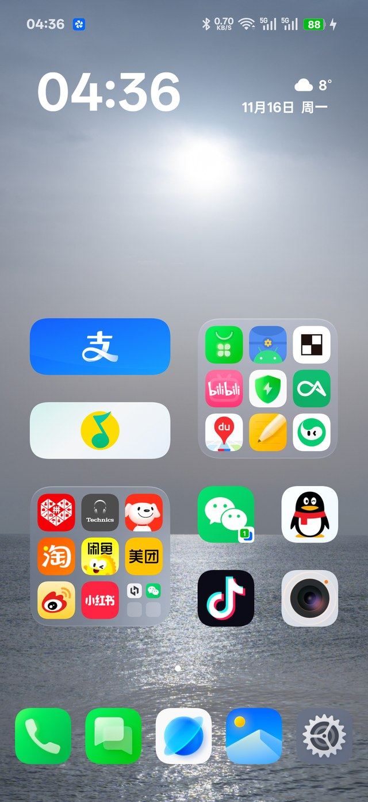
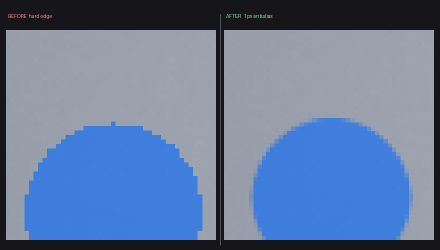

# 晕动舒缓显示 · 欧加通用模块

给**缺少「晕动舒缓显示」的 OPPO / 一加 / realme（欧加）ColorOS 机型**补全原生功能。

基于 KernelSU + LSPosed。圆点由**原厂 `AntiDizzyView` 绘制**，模块只做三件事：解开被隐藏的特性开关、用手机自带传感器替代缺失的车辆传感器、给原厂圆点补上边缘抗锯齿。



## 为什么需要它

ColorOS 16 的「晕动舒缓显示」（设置 → 辅助功能）会在屏幕两侧绘制一列随车辆运动反向滑动的圆点，缓解坐车看屏幕的晕动感。但这功能被机型白名单锁死，名单外的机器设置里开关是灰的。

拆包对比后发现：**固件里这套实现本来就是完整的**——`oplus-services.jar` 里 `AntiDizzyManager` / `AntiDizzyView` / `AntiDizzyMotionAlgorithm` 全都在，Settings 的设置页和预览动画也在。缺的只有两样：

| 缺什么 | 性质 | 模块怎么办 |
|---|---|---|
| `com.oplus.features_config.xml` 里的一行 `<oplus-feature name="oplus.hardware.display.motion_sickness"/>` | 软件门控 | 开机自动探测并 bind mount 补上 |
| 两颗 OPPO 私有传感器 `33171091`(car motion) / `33171092`(car scene) | 硬件差异 | LSPosed 注入 system_server，用标准传感器喂数据 |

## 特点

**适配**

- 开机探测 7 个候选配置路径，不写死机型
- 原厂已有 car motion / car scene 传感器 → **自动退出不注入**，对原生支持的机型零影响
- 传感器逐项降级：线性加速度 → 加速度计去重力；有重力传感器才算振动方向；无陀螺也能跑
- 类名 / 字段名 / 方法名多套备选，跨版本兼容

**算法**

- 圆点抗锯齿用 `fwidth` 按像素计算过渡宽度，**任何分辨率 / DPI / 球尺寸都是 1px 过渡，零配置**
- 车辆识别用五维特征（振动能量、1–6Hz 低频占比、重力方向占比、陀螺 RMS、步频自相关），陀螺是**否决**条件而非触发条件，另加 8 秒手持抑制

抗锯齿前后对比（放大 10 倍）：



## 安装

1. KernelSU → 模块 → 从本地安装 → `dist/oplus-antidizzy-module-v5.0.zip` → 重启
2. 打开 **LSPosed** → 模块 → 勾选 **AntiDizzy Bridge** → 作用域只勾 **系统框架** → 重启
3. 设置 → 辅助功能 → 晕动舒缓显示 → 开启

> 第 2 步必须手工做。LSPosed 的配置是 SQLite 库，KernelSU 写不了，这是整个流程里唯一需要动手的地方。
>
> 更新模块后需**整机重启**（`pm install` 会改变 APK 路径，而 LSPosed 在 zygote 里缓存旧路径）。
> 模块更新时不会触发 `uninstall.sh`，可以放心覆盖安装。

## 卸载

在 KernelSU 里删除模块即可，模块会自己收拾干净：

- `uninstall.sh` 在删除瞬间卸载 APK（同时停掉注入）、删除写入的 Settings 键、**立即 umount** 三个 bind mount、清理临时文件
- 另有一个「墓碑」脚本放在 `/data/adb/service.d/`，万一 `uninstall.sh` 没跑成，下次开机会补做并自删

分区文件全程未被修改（只读 EROFS + bind mount 覆盖），`umount` 后即为原样。

## 构建

需要 JDK 17+、Android build-tools、`android.jar`（API 33+）：

```bash
export ANDROID_JAR=$ANDROID_HOME/platforms/android-36/android.jar
export BUILD_TOOLS=$ANDROID_HOME/build-tools/35.0.0

./build/build-apk.sh      # 编译 LSPosed 模块 → dist/AntiDizzyBridge.apk
./build/build-module.sh   # 打包成可刷入的模块 zip → dist/*.zip
```

> `aapt2` 不支持非 ASCII 路径，项目必须放在纯英文目录下。构建脚本会提前检查并提示。

## 项目结构

```
module/            KernelSU 模块（module.prop + 四个脚本）
  post-fs-data.sh    探测并 patch 特性配置，bind mount
  service.sh         安装桥接 APK、部署卸载墓碑
  cleanup.sh         清理逻辑（uninstall.sh 与墓碑共用）
  uninstall.sh       模块被删除时执行
xposed/            LSPosed 模块源码
  src/               Bridge.java（注入与调度）、VehicleDetector.java（车辆识别）
  stub/              Xposed API 编译期桩（不进 dex，运行时由 LSPosed 提供）
  assets/xposed_init 入口声明
build/             构建脚本
dist/              预编译产物
docs/              技术文档、论坛文案、截图
tools/dalvik.py    DEX 反汇编工具（逆向时用）
```

## 兼容性

| 系统 | 状态 |
|---|---|
| ColorOS 16（Android 16） | ✅ 主力适配与验证 |
| ColorOS 15 及更早 | ⚠️ 若固件内含 AntiDizzy 实现理论可用，未验证 |
| ColorOS 17 | ⚠️ 未验证。模块对包名 `com.android.server.display.feature.antidizzy` 是硬依赖，厂商重构则失效；失效表现为「不生效」而非崩溃 |

**前提**：`oplus-services.jar` 里必须有 `com.android.server.display.feature.antidizzy.*`。完全没有这套代码的老机型，模块无能为力（日志会打印「找不到 AntiDizzyManager」）。

## 已知限制

- `car scene` 是**行为近似**。原厂判断的是"场景"（可能融合车机连接、GPS、地磁），本模块判断的是"振动特征"。公交/地铁上可能与原厂有差异。
- 抗锯齿依赖 `GL_OES_standard_derivatives`（GLES2 可选项，实际支持率接近 100%）；不支持时退化为固定宽度平滑。
- LSPosed 作用域需手动勾选。

## 文档

- [技术文档](docs/technical-notes.md)：完整的逆向结论、算法原理、调试命令、调参表
- [论坛文案（精简）](docs/promo-short.md) / [（详细）](docs/promo-detailed.md)

## 免责声明

本项目通过逆向分析实现功能补全，**未包含或分发任何来自 OPPO 的代码或资源**。所有绘制与算法均调用设备固件中已有的原厂实现。

涉及 root、KernelSU、LSPosed 操作，刷机有风险。模块只做配置文件 bind mount 和 system_server 内的传感器数据注入，不改动任何分区内容。请自行评估风险。

## License

[MIT](LICENSE)
